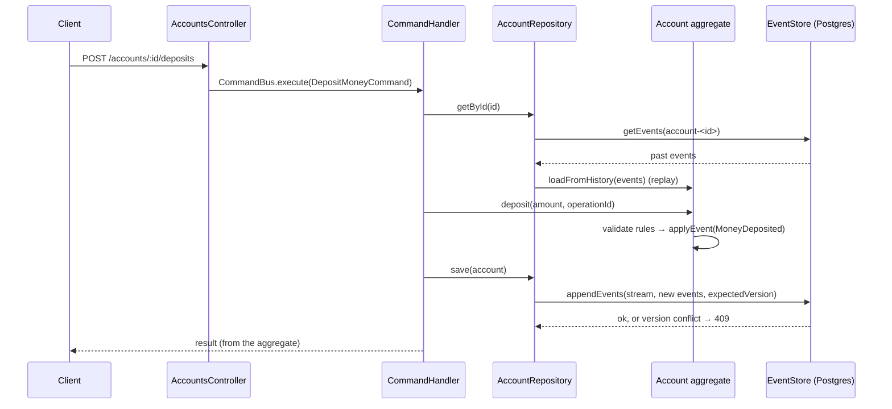

# Banking System — Event Sourcing practice

A learning project: a small banking domain built with **Event Sourcing** and
**CQRS** on NestJS 12 and [`@ocoda/event-sourcing`](https://ocoda.github.io/event-sourcing) 4.1,
persisted in PostgreSQL 17. Not a production banking system.

**Status: Phase 2 plus withdrawals, bearer-token authentication, and audited
support lookups.** You can open accounts, deposit and withdraw money, view event
history, and rebuild account state by replay. Every route requires a bearer token.
Internal withdrawal-history and support-lookup handlers exist but have **no HTTP
route yet** (see [Audit and internal lookups](#audit-and-internal-lookups)).
Transfers and projected read models are Phase 3. See
[docs/architecture.md](docs/architecture.md) and [docs/learning-log.md](docs/learning-log.md).

## Requirements

- Node.js **24.15+** (pinned in `.nvmrc`; NestJS 12 schematics and Ocoda 4 need it)
- Docker (for PostgreSQL)

## Setup

```bash
nvm use                 # Node 24.22.0 from .nvmrc
npm install
cp .env.example .env    # local docker-compose credentials only
docker compose up -d --wait
```

`docker compose` starts one Postgres container on host port **5433** with two
databases: `banking` (app) and `banking_test` (integration tests). The app
creates Ocoda's `events` table on startup (`ensureCollection`, `ddl: 'auto'`)
and the `audit_records` table if it is missing.

Set these in `.env` (see `.env.example`; never commit real values):

| Variable | Required | Purpose |
|---|---|---|
| `DATABASE_URL` | yes | App database. |
| `TEST_DATABASE_URL` | for `test:e2e` | Integration-test database. |
| `PORT` | no | HTTP port (default 3000). |
| `JWT_SECRET` | yes | Key that signs and verifies bearer tokens. At least 32 characters with at least 16 distinct ones. The app refuses to start if it is missing, too weak, or the public test key. Generate one locally, for example `openssl rand -base64 48`. |
| `AUDIT_WRITE_TIMEOUT_MS` | no | How long one audit write may take before a support lookup fails closed. Integer from 1 to 60000 (default 2000). |

## Run

```bash
npm run start:dev       # watch mode, http://localhost:3000
```

## Test and check

```bash
npm test                # unit + HTTP flow tests (in-memory event store, no DB)
npm run test:e2e        # integration tests against Postgres (banking_test)
npm run typecheck
npm run lint
npm run build
```

## Authentication

Every route requires `Authorization: Bearer <token>`. There is no token issuer
in this repository: tokens must be signed by a trusted issuer, and none exists
yet (production release stays blocked on that and on signing-key ownership).

A token is accepted only if all of these hold:

- signed with `HS256` using `JWT_SECRET`;
- issuer and audience match the values in `src/auth/jwt-options.ts` (implementer
  defaults, not confirmed with a trusted issuer);
- carries `sub`, `role`, `iat` and `exp`, and its age is at most 15 minutes
  (a far-future `exp` does not extend this);
- `iat` is not more than 60 seconds in the future;
- `role` is on the allow-list. Only `INTERNAL_SUPPORT` is recognised today, so
  no customer token can be accepted.

`GET /accounts/:id/events` also requires the `INTERNAL_SUPPORT` role. Rotation
is manual: change `JWT_SECRET` and restart, which invalidates every outstanding
token at once. Account ownership is not checked. For tests, `test/support/test-tokens.ts`
signs tokens with a test-only key that the app refuses to run with.

## API

Amounts are **integer minor units** (`1050` = 10.50). `operationId` is a
client-generated idempotency key: resending the same request is a safe no-op.
A key belongs to one operation type: a withdrawal cannot reuse a deposit's key,
or the reverse (409 `OPERATION_ID_REUSED`). Request bodies reject unknown
properties with 400.

The examples assume `TOKEN` holds a valid bearer token (see
[Authentication](#authentication)).

```bash
# Open an account (currency defaults to EUR)
curl -s -X POST localhost:3000/accounts \
  -H "authorization: Bearer $TOKEN" \
  -H 'content-type: application/json' -d '{"ownerName":"Ada"}'
# → {"accountId":"<uuid>"}

# Deposit
curl -s -X POST localhost:3000/accounts/<uuid>/deposits \
  -H "authorization: Bearer $TOKEN" \
  -H 'content-type: application/json' -d '{"amountMinor":2500,"operationId":"dep-1"}'
# → {"accountId":"<uuid>","operationId":"dep-1","status":"deposited","balanceMinor":2500}
#   (sending it again returns "status":"duplicate" and stores nothing)

# Withdraw (allowed up to the full balance)
curl -s -X POST localhost:3000/accounts/<uuid>/withdrawals \
  -H "authorization: Bearer $TOKEN" \
  -H 'content-type: application/json' -d '{"amountMinor":1000,"operationId":"wd-1"}'
# → {"accountId":"<uuid>","operationId":"wd-1","status":"withdrawn","balanceMinor":1500}
#   (a retry returns "status":"duplicate"; an amount above the balance returns 422
#   INSUFFICIENT_FUNDS and stores nothing)

# Current state, rebuilt by replaying the stream
curl -s -H "authorization: Bearer $TOKEN" localhost:3000/accounts/<uuid>

# Event history, straight from the event store (needs the INTERNAL_SUPPORT role)
curl -s -H "authorization: Bearer $TOKEN" localhost:3000/accounts/<uuid>/events

# One deposit, found by its operationId in the account's stream
curl -s -H "authorization: Bearer $TOKEN" localhost:3000/accounts/<uuid>/deposits/dep-1
# → {"accountId":"<uuid>","operationId":"dep-1","amountMinor":2500}
```

| Error | Status | `code` |
|---|---|---|
| Invalid body / id | 400 | (validation message) / `INVALID_AMOUNT`, `INVALID_CURRENCY`, `INVALID_OWNER_NAME`, `INVALID_ID` |
| Missing, malformed, expired or otherwise invalid token | 401 | `UNAUTHENTICATED` (with a `WWW-Authenticate: Bearer` challenge) |
| Valid token without the role the route needs | 403 | `FORBIDDEN` |
| Unknown account | 404 | `ACCOUNT_NOT_FOUND` |
| Account exists but has no deposit with that `operationId` | 404 | `DEPOSIT_NOT_FOUND` |
| Withdrawal above the balance | 422 | `INSUFFICIENT_FUNDS` |
| `operationId` reused with another amount, or with another operation type | 409 | `OPERATION_ID_REUSED` |
| Concurrent write to the same account (the losing writer retries) | 409 | `CONCURRENCY_CONFLICT` |

## Audit and internal lookups

Three read handlers exist for withdrawal visibility. **None is registered in a
module or reachable over HTTP**, so they are not part of the API above:

| Handler | Purpose | Audited |
|---|---|---|
| `GetWithdrawalHistoryHandler` | One account's successful withdrawals, newest first, paged, with a date filter. | No (customer audit is not built) |
| `GetWithdrawalDetailsHandler` | One withdrawal by `operationId` (404 `WITHDRAWAL_NOT_FOUND` if none). | Yes |
| `ListSupportWithdrawalsHandler` | Support search by date range and page size. Bad input gives 400 `INVALID_DATE_RANGE`, `INVALID_DATE`, `FUTURE_DATE` or `INVALID_PAGE_SIZE`. | Yes |

Support lookups are audited and **fail closed**. Each attempt writes one row to
the `audit_records` table (kept apart from the account streams): who looked
(the token's `sub`), which account, the query as received, the case ID and note,
the outcome (`success` or `rejected`, with a reason code) and the result count.
If the row cannot be written within `AUDIT_WRITE_TIMEOUT_MS`, the caller gets
503 `AUDIT_UNAVAILABLE` and no data. A lookup with no audit context is refused
(500 `AUDIT_CONTEXT_MISSING`).

Known limits: a write that times out may still commit, so a row can say
`success` while the caller received 503. Case-ID validation, auditing of 403
denials, an audit-reader role, retention, and the append-only grant for the app
database role are not done.

Inspect the raw event store:

```bash
docker compose exec postgres psql -U banking -d banking \
  -c "select stream_id, version, event, payload, global_position from events order by global_position"
```

## Event flow


