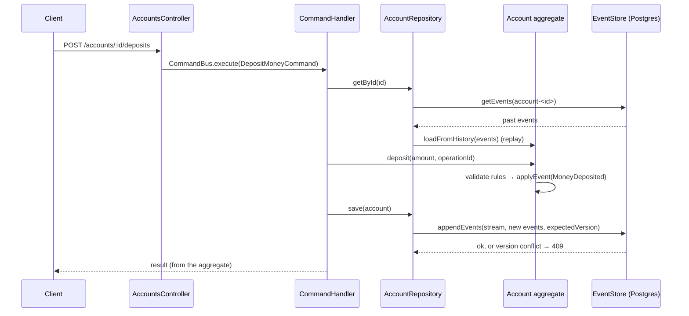

# Banking System — Event Sourcing practice

A learning project: a small banking domain built with **Event Sourcing** and
**CQRS** on NestJS 12 and [`@ocoda/event-sourcing`](https://ocoda.github.io/event-sourcing) 4.1,
persisted in PostgreSQL 17. Not a production banking system.

**Status: Phase 2.** You can open accounts, deposit money, view event history,
and rebuild account state by replay. Withdrawals, transfers and projected read
models are Phase 3. See [docs/architecture.md](docs/architecture.md) and
[docs/learning-log.md](docs/learning-log.md).

## Requirements

- Node.js **24.15+** (pinned in `.nvmrc`; NestJS 12 schematics and Ocoda 4 need it)
- Docker (for PostgreSQL)

## Setup

```bash
nvm use                 # Node 24.22.0 from .nvmrc
npm install
cp .env.example .env    # local docker-compose credentials only
docker compose up -d --wait
```

`docker compose` starts one Postgres container on host port **5433** with two
databases: `banking` (app) and `banking_test` (integration tests). The app
creates Ocoda's `events` table on startup (`ensureCollection`, `ddl: 'auto'`).

## Run

```bash
npm run start:dev       # watch mode, http://localhost:3000
```

## Test and check

```bash
npm test                # unit + HTTP flow tests (in-memory event store, no DB)
npm run test:e2e        # integration tests against Postgres (banking_test)
npm run typecheck
npm run lint
npm run build
```

## API (Phase 2)

Amounts are **integer minor units** (`1050` = 10.50). `operationId` is a
client-generated idempotency key: resending the same request is a safe no-op.

```bash
# Open an account (currency defaults to EUR)
curl -s -X POST localhost:3000/accounts \
  -H 'content-type: application/json' -d '{"ownerName":"Ada"}'
# → {"accountId":"<uuid>"}

# Deposit
curl -s -X POST localhost:3000/accounts/<uuid>/deposits \
  -H 'content-type: application/json' -d '{"amountMinor":2500,"operationId":"dep-1"}'
# → {"accountId":"<uuid>","operationId":"dep-1","status":"deposited","balanceMinor":2500}
#   (sending it again returns "status":"duplicate" and stores nothing)

# Current state, rebuilt by replaying the stream
curl -s localhost:3000/accounts/<uuid>

# Event history, straight from the event store
curl -s localhost:3000/accounts/<uuid>/events

# One deposit, found by its operationId in the account's stream
curl -s localhost:3000/accounts/<uuid>/deposits/dep-1
# → {"accountId":"<uuid>","operationId":"dep-1","amountMinor":2500}
```

| Error | Status | `code` |
|---|---|---|
| Invalid body / id | 400 | (validation message) / `INVALID_AMOUNT`, `INVALID_ID` |
| Unknown account | 404 | `ACCOUNT_NOT_FOUND` |
| Account exists but has no deposit with that `operationId` | 404 | `DEPOSIT_NOT_FOUND` |
| `operationId` reused with another amount | 409 | `OPERATION_ID_REUSED` |
| Concurrent write to the same account | 409 | `CONCURRENCY_CONFLICT` |

Inspect the raw event store:

```bash
docker compose exec postgres psql -U banking -d banking \
  -c "select stream_id, version, event, payload, global_position from events order by global_position"
```

## Event flow


